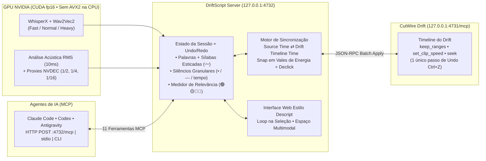

# DriftScript ✂️🎬

<p align="center">
  <strong>Editor de vídeo baseado em texto (estilo <em>Descript</em>) e servidor MCP para o CutWire Drift</strong><br/>
  <em>Corte, acelere, encurte silêncios e filtre relevância com IA editando o vídeo como se fosse um documento de texto.</em>
</p>

<p align="center">
  
  
  
  
  
  
</p>

---

## 📖 Visão Geral

O **DriftScript** transforma a edição de vídeo no **CutWire Drift** em uma experiência fluida de edição de texto inspirada no *Descript*, combinando **sincronização acústica de precisão milimétrica (10 ms)** com controle total por **agentes de Inteligência Artificial via MCP (*Model Context Protocol*)**.

Em vez de caçar ondas sonoras manualmente na timeline:
- **Clique em qualquer palavra ou pausa** para posicionar instantaneamente o player e a agulha (*playhead*) do Drift.
- **Riscar em vez de apagar**: palavras e silêncios cortados não somem do texto — ficam **riscados** (`line-through`) e podem ser ouvidos ou restaurados a qualquer momento.
- **Acelerar em vez de cortar (`2x` ou `4x`)**: mantenha a fluidez visual acelerando pausas ou explicações secundárias em vez de produzir cortes secos (*jump cuts*).
- **Edição assistida por IA**: copie o prompt integrado com 1 clique ou conecte qualquer agente compatível com MCP (**Antigravity**, **Claude Code**, **Codex**, **Cursor**) para limpar vícios de linguagem, gaguejos, repetições e classificar a relevância de cada fala com código de cores.

---

## 🏗️ Arquitetura e Fluxo de Sincronização



---

## ✨ Principais Recursos

### 1. Edição Não-Destrutiva, Seleção Estilo Editor de Texto e Barra de Espaço Multimodal
- **Palavras Riscadas**: nada é perdido ao cortar. O texto cortado permanece visível e riscado em vermelho, sendo pulado automaticamente durante a reprodução.
- **Cursor e Seleção Estilo Editor de Texto**:
  - **1x Clique Esquerdo**: posiciona o cursor (`|`) na palavra clicada e **começa a tocar o áudio imediatamente** a partir dali (sem selecionar por padrão).
  - **2x Clique Esquerdo**: seleciona a palavra clicada; **3x Clique Esquerdo**: seleciona o parágrafo inteiro.
  - **Clicar e Arrastar**: seleciona um bloco contínuo de texto entre o início e o fim do arrasto.
  - **Segurar `Ctrl` + Clicar ou Arrastar**: seleciona partes diferentes de forma descontínua.
  - **Setas e `Shift + Setas`**: move o cursor pelo texto ou expande/reduz a seleção contínua; `Ctrl+A` seleciona todo o texto da transcrição.
- **Play em Loop na Seleção (`▶ Play` / `⏸ Loop`)**: quando há palavras ou pausas selecionadas, o botão **Play** toca exclusivamente o trecho selecionado em **loop contínuo**, permitindo avaliar o corte com precisão cirúrgica. O botão **`⏮ Do Zero`** toca o vídeo inteiro desde o início.
- **Modo da Barra de Espaço Selecionável (`✂ Riscar` vs. `⚡ Acelerar`)**:
  - Escolha na barra de ferramentas qual ação será disparada pela **Barra de Espaço**:
    - **`✂ Riscar [Espaço]`**: alterna (*toggle*) toda a seleção entre **riscado** e **não riscado**.
    - **`⚡ Acelerar [Espaço]`**: alterna (*toggle*) toda a seleção entre a velocidade escolhida (**`2x` ou `4x`**) e a velocidade normal (**`1x`**).
- **Indicador de Novo Comprimento**: localizado logo abaixo do vídeo, exibe em tempo real a nova duração líquida do vídeo e o tempo total economizado com cortes e acelerações.

---

### 2. Decomposição Granular de Silêncios (`•`, `—`, `(tempo)`)
Inspirado no controle fino de pausas do *Descript*, mas com granularidade total para cortar ou acelerar **apenas parte de um silêncio**:

| Símbolo no Texto | Equivalência de Tempo | Regra de Exibição |
| :--- | :--- | :--- |
| **`•`** *(1 pontinho)* | **`0.05s`** (`50 ms`) | Unidade base de silêncio. Silêncio mínimo detectado: `2 pontinhos` (`0.10s`). |
| **`—`** *(1 traço)* | **`0.50s`** (`10 pontinhos`) | Só aparece a partir de **12 pontinhos** (`0.60s`), pois o **primeiro e o último token de qualquer conjunto são sempre pontinhos (`•`)**: `• — •` (`1 + 10 + 1 = 12`). |
| **`• (2.4s) •`** | **`> 2.10s`** (`> 4 traços`) | Silêncios superiores a 4 traços (`> 42 pontinhos`) exibem a duração central entre dois pontinhos de borda. |

> **Por que o primeiro e o último elemento são sempre pontinhos (`•`)?**
> Para permitir que o filtro **"Selecionar Silêncios"** (com a opção `Manter pontas •` ativa) selecione automaticamente apenas o **miolo** do silêncio, preservando `50 ms` de respiração natural na saída da palavra anterior e `50 ms` na entrada da palavra seguinte — eliminando o efeito artificial de fala "picotada".

---

### 3. Detecção Acústica de Sílabas Esticadas (`〰`)
Quando o locutor estica uma vogal ou nasalização enquanto pensa no que vai dizer (*"éeeeehhh"*, *"queeeee"*, *"vamooooosss"*):
- O motor acústico analisa a sustentação contínua de energia vocal em janelas de `10 ms` após a duração fonética normal da palavra.
- A parte esticada é separada em um token anexado **`〰0.35s`** (`kind: "stretch"`).
- Ao riscar ou acelerar apenas o token **`〰`**, você **encurta a sílaba esticada** preservando a pronúncia natural da palavra original!
- **Proteção contra falsos positivos técnicos**: números, decimais, unidades de medida (`3.3V`, `2,4835`), siglas em maiúsculas (`SDR`, `BLE`, `MHz`) e termos compostos (`Wi-Fi`) possuem pronúncia falada muito mais longa do que sua grafia curta (*"3.3V"* = *"três ponto três volts"*) e são automaticamente protegidos para nunca serem divididos como sílabas esticadas.

---

### 4. Medidor de Relevância por IA (Verde → Amarelo → Vermelho | Azul)
O DriftScript inclui um **Medidor de Relevância** na barra de ferramentas que se inicia neutro (todo o texto em branco) e permite que um modelo de IA classifique semanticamente toda a transcrição:

| Cor no Texto | Categoria / Score | Significado Semântico |
| :--- | :--- | :--- |
| 🟢 **Verde** | `relevant` (`0.70` a `1.00`) | **Alta Relevância**: tese central, explicações técnicas essenciais, demonstrações principais. |
| 🟡 **Amarelo** | `relevant` (`0.40` a `0.69`) | **Média Relevância**: contextualização útil, exemplos secundários, transições de raciocínio. |
| 🔴 **Vermelho** | `relevant` (`0.00` a `0.39`) | **Baixa Relevância / Redundância**: ideias repetidas, rodeios prolixos, frases recomeçadas (*false starts*). |
| 🔵 **Azul** | `off_topic` (`0.00`) | **Fora do Assunto / Desvio**: comentários de bastidores (*"deixa eu arrumar a câmera"*), interrupções externas, tangentes. |

Após a análise da IA, você pode usar o seletor rápido da barra de ferramentas para **selecionar com 1 clique** todos os trechos `🔴 Pouco Relevantes` ou `🔵 Fora do Assunto` e decidir se deseja riscá-los ou acelerá-los.

---

### 5. Três Perfis Whisper com Monitoramento de VRAM + Compatibilidade Sem AVX2

| Perfil | Modelo Whisper | VRAM Estimada | Indicação de Uso |
| :--- | :--- | :--- | :--- |
| **Fast** | `small` | **`~1.2 GB`** | Rascunhos rápidos e máquinas com pouca VRAM livre. |
| **Normal** | `medium` | **`~2.8 GB`** | Equilíbrio ideal entre velocidade e precisão em português e inglês. |
| **Heavy** | `large-v3` | **`~4.8 GB`** | Máxima precisão para jargões técnicos, siglas e fala acelerada. |

- **Persistência Automática**: o último perfil escolhido (`Fast`, `Normal` ou `Heavy`) é salvo automaticamente como padrão para as próximas sessões.
- **Monitor de VRAM ao Vivo**: exibe no topo o consumo atual da placa de vídeo (`usado / total GB`), a barra de projeção de memória do perfil selecionado e o botão **Liberar** para descarregar o modelo da VRAM após transcrever.
- **Zero Dependência de AVX2 na CPU**: prioriza sempre a placa de vídeo via **CUDA (`float16`)** e evita instruções vetoriais `AVX2` na CPU, rodando perfeitamente em processadores como **Intel Xeon E5-2696 v2 (Ivy Bridge)** e similares.

---

### 6. Visualização Fluida em Baixa Resolução (`1x`, `1/2`, `1/4`, `1/16`)
Para garantir que a pré-visualização nunca engasgue ao pular dezenas de microcortes em vídeos longos ou de alta taxa de bits:
- Alterne a qualquer momento entre **`1x`** (original), **`1/2`**, **`1/4`** e **`1/16`** da resolução.
- Os proxies são gerados automaticamente com decodificação via hardware (**NVDEC `-hwaccel cuda`**) e *keyframes* ultracurtos (`-g 4 -tune fastdecode`), permitindo buscas (`seek`) instantâneas no navegador.

---

## ⌨️ Atalhos de Teclado e Mouse

| Atalho / Ação | Efeito no Editor |
| :--- | :--- |
| **1x Clique Esquerdo** | Posiciona o cursor na palavra/pausa e **começa a tocar o áudio imediatamente** a partir dali (sem selecionar). |
| **2x Clique Esquerdo** | Seleciona a palavra clicada (3x Clique seleciona o parágrafo inteiro). |
| **Clicar e Arrastar** | Seleciona de forma contínua do ponto inicial até a posição atual do mouse. |
| **`Ctrl + Clique` ou `Ctrl + Arrastar`** | Seleciona partes diferentes (seleção múltipla descontínua). |
| **`Setas` / `Shift + Setas`** | Move o cursor pelo texto ou expande/reduz a seleção contínua a partir do cursor. |
| **`Ctrl + A`** *(ou `Cmd + A`)* | Seleciona todo o texto da transcrição (sem selecionar o HTML da página). |
| **`Espaço`** *(Barra de Espaço)* | **Alterna (*toggle*) o modo ativo** (`✂ Riscar` ou `⚡ Acelerar 2x/4x`) em toda a seleção atual (ou dá Play/Pause se nada estiver selecionado). |
| **Botão Direito do Mouse** | **Desrisca** imediatamente o item clicado ou toda a seleção atual. |
| **`Delete` / `Backspace`** | **Risca** (`deleted = true`) todos os itens selecionados. |
| **`Esc`** | Limpa a seleção atual. |
| **`Ctrl + Z` / `Ctrl + Y`** | Desfaz / Refaz a última alteração de corte ou velocidade. |
| **`▶ Play`** *(com seleção ativa)* | Toca **apenas a seleção atual em loop contínuo** (`⏸ Loop`). |
| **`⏮ Do Zero`** | Desativa o loop de seleção e toca o vídeo inteiro desde `00:00`. |

---

## 🚀 Instalação e Execução

### Pré-requisitos
- **Linux** com Python `3.10+` e `ffmpeg` instalado no sistema.
- **CutWire Drift** aberto com o servidor MCP ativo (porta padrão `4731`).
- *(Recomendado)* Placa de vídeo **NVIDIA** com suporte a CUDA para transcrição acelerada em `float16`.

### 1. Clonar e Iniciar
O script `run.sh` detecta (ou cria) o ambiente virtual `.venv` e inicia o servidor na porta `4732`:

```bash
git clone https://github.com/TyrionV8/DriftScript.git
cd DriftScript
./run.sh
```

Acesse a interface no navegador:
👉 **`http://127.0.0.1:4732`**

### 2. Configurar o MCP para Agentes de IA (Antigravity, Claude Code e Codex)
Para que seus assistentes de IA possam editar o vídeo diretamente pelo chat, registre o servidor MCP com um único comando:

```bash
python3 driftscript_cli.py configurar-mcp
```

*(Ou clique no botão **`📋 Copiar Prompt IA`** no topo da interface web para copiar as instruções prontas para qualquer chat).*

---

## 🤖 Ferramentas MCP Disponíveis (`http://127.0.0.1:4732/mcp`)

O DriftScript expõe **11 ferramentas MCP** (tanto via **HTTP POST JSON-RPC 2.0** em `http://127.0.0.1:4732/mcp` quanto via **`stdio`** com `python -m driftscript.mcp_server`):

| Ferramenta MCP | Descrição |
| :--- | :--- |
| `driftscript_memory_status` | Retorna o uso de VRAM da GPU, RAM, capacidades da CPU (AVX/AVX2), perfil carregado e estimativas dos modos `fast`, `normal` e `heavy` (ou descarrega a VRAM com `unload: true`). |
| `driftscript_list_clips` | Lista todos os assets de vídeo e clipes presentes na timeline aberta do CutWire Drift. |
| `driftscript_transcribe` | Transcreve um vídeo no perfil escolhido (`fast`, `normal`, `heavy`), aplicando alinhamento fonético, ajuste acústico RMS (10ms), separação de sílabas esticadas (`〰`) e silêncios granulares (`•`, `—`). |
| `driftscript_get_transcript` | Retorna a transcrição indexada palavra por palavra (`[idx] palavra`, `[idx] ~palavra~` quando riscada, `[idx] ⚡2x palavra` quando acelerada), além de estatísticas de duração. |
| `driftscript_search_words` | Busca palavras/frases específicas e detecta automaticamente candidatos a corte: vícios de linguagem (*"é"*, *"hum"*, *"tipo"*, *"né"*), gaguejos/repetições imediatas e pausas longas. |
| `driftscript_cut_words` | Risca (`deleted: true`) ou restaura (`deleted: false`) tokens por lista de `indices` ou intervalos `ranges` (`[[início, fim]]`) e sincroniza imediatamente a timeline do Drift. |
| `driftscript_restore_words` | Desrisca tokens por `indices`, `ranges` ou `restore_all: true` e atualiza a timeline do Drift. |
| `driftscript_accelerate_words` | Acelera (`speed`: `2` ou `4`, ou `1.0` para restaurar) palavras, silêncios ou sílabas esticadas por `indices` ou `ranges`. |
| `driftscript_set_relevance` | Colore o Medidor de Relevância atribuindo `score` (`0.0` vermelho → `0.5` amarelo → `1.0` verde) e `category` (`"relevant"` ou `"off_topic"` para azul) com justificativa (`reason`) em intervalos `[start_index, end_index]`. |
| `driftscript_seek_word` | Move a agulha (*playhead*) do CutWire Drift e do player web para o tempo exato da palavra `word_index`. |
| `driftscript_sync_drift` | Força a ressincronização imediata dos intervalos mantidos (`keep_ranges`) e velocidades com a timeline do CutWire Drift. |

### Exemplos de Uso via CLI (`driftscript_cli.py`)

```bash
# 1. Verificar status da GPU VRAM e conexão com o CutWire Drift
python3 driftscript_cli.py status

# 2. Ler a transcrição formatada com índices [idx]
python3 driftscript_cli.py chamar driftscript_get_transcript '{"limit": 500}'

# 3. Detectar vícios de linguagem, repetições e pausas
python3 driftscript_cli.py chamar driftscript_search_words '{"include_candidates": true, "min_pause_sec": 0.4}'

# 4. Riscar palavras ou silêncios por índice e intervalo
python3 driftscript_cli.py chamar driftscript_cut_words '{"indices": [12, 13], "ranges": [[40, 48]], "deleted": true}'

# 5. Acelerar um trecho em 2x em vez de cortar
python3 driftscript_cli.py chamar driftscript_accelerate_words '{"ranges": [[100, 135]], "speed": 2.0}'

# 6. Colorir o Medidor de Relevância
python3 driftscript_cli.py chamar driftscript_set_relevance '{
  "annotations": [
    {"start_index": 0, "end_index": 64, "score": 0.95, "category": "relevant", "reason": "Explicação central do projeto"},
    {"start_index": 65, "end_index": 90, "score": 0.0, "category": "off_topic", "reason": "Ajuste do tripé da câmera"}
  ]
}'
```

---

## 📂 Estrutura do Projeto

```text
DriftScript/
├── README.md                  # Documentação completa do projeto
├── LICENSE                    # Licença MIT
├── pyproject.toml             # Metadados do pacote e entrypoints CLI/MCP
├── requirements.txt           # Dependências Python (FastAPI, Uvicorn, NumPy, Whisper/WhisperX)
├── run.sh                     # Script de inicialização rápida (porta 4732)
├── driftscript_cli.py         # CLI para agentes de IA e autoconfiguração MCP (Antigravity/Claude/Codex)
├── driftscript/
│   ├── __init__.py
│   ├── config.py              # Perfis de memória Whisper (Fast/Normal/Heavy) e telemetria GPU/RAM/CPU
│   ├── drift_client.py        # Cliente JSON-RPC para o servidor MCP do CutWire Drift (:4731)
│   ├── transcriber.py         # Motor Whisper CUDA fp16 + ajuste RMS (10ms) + sílabas esticadas (〰) + silêncios (•/—)
│   ├── sync_engine.py         # Conversão Source ⇄ Timeline, fusão de keep_ranges, velocidades e snap acústico
│   ├── state.py               # Gerenciamento de sessão, persistência em disco, Undo/Redo e relevância
│   ├── mcp_server.py          # Servidor MCP completo (HTTP POST /mcp + stdio) com 11 ferramentas
│   ├── server.py              # Servidor FastAPI, Streaming HTTP 206 Partial Content e gerador de proxies NVDEC
│   └── static/
│       ├── index.html         # Interface Descript-style limpa e focada no texto e vídeo grande
│       ├── styles.css         # Estilização dark mode com scroll largo à esquerda e indicadores visuais
│       └── app.js             # Player sincronizado, loop na seleção, barra de espaço multimodal e atalhos
└── tests/
    └── test_sync.py           # Suíte de testes unitários (sincronia, silêncios granulares, sílabas esticadas)
```

---

## 🧪 Executando os Testes

```bash
PYTHONPATH=. ./.venv/bin/python tests/test_sync.py -v
```

---

## 📄 Licença

Distribuído sob a licença **MIT**. Veja o arquivo [LICENSE](LICENSE) para mais detalhes.
